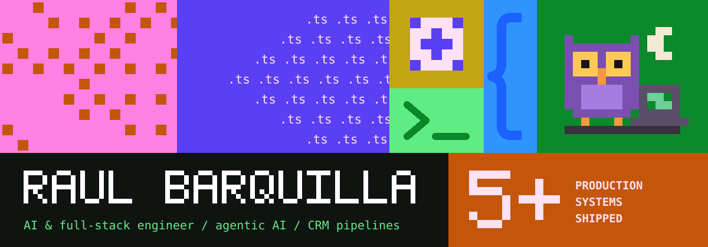

AI and full-stack engineer in Albay, Philippines. I build agentic systems on Claude and GPT, wire them into CRMs and internal tools, and run them on infrastructure I secure myself.



```console
$ whoami --verbose
role       AI & full-stack engineer
focus      agentic AI, CRM and lead pipelines, system architecture
stack      TypeScript · Next.js · React · Node.js · PostgreSQL · Docker
status     open to part-time or contract
```

<details>
<summary><b>What each agent actually does</b></summary>
<br />

- **claude-agent.** Claude and GPT integrations, prompt engineering, and LLM token and cost management that holds up in production.
- **lead-router.** Lead intake into Salesforce with webhook signature verification, idempotency keys and round-robin routing. Outbound GTM with HubSpot sync and Aircall calling.
- **infra-ops.** CI/CD, Docker, and VPS administration on OVHcloud over SSH. Auth tokens, sessions, and signed webhooks.
- **it-desk.** Level 3 escalation for hardware and software, plus IT asset management.

</details>

#### Projects

Most of my work is for clients, so it lives in private repositories. These are the ones you can read.

<p>
<a href="https://github.com/hakkuuuu/travel-app"></a>
<a href="https://github.com/hakkuuuu/hakoverse"></a>
<a href="https://github.com/hakkuuuu/Hakostore"></a>
<a href="https://github.com/hakkuuuu/hakomovies"></a>
<a href="https://github.com/hakkuuuu/raulbarquilla-portfolio"></a>
<a href="https://raulbarquilla-portfolio.vercel.app/#projects"></a>
</p>

#### Reach me

[Portfolio](https://raulbarquilla-portfolio.vercel.app) · [LinkedIn](https://www.linkedin.com/in/raulbjr/) · [Email](mailto:raulbarquilla003@gmail.com)
